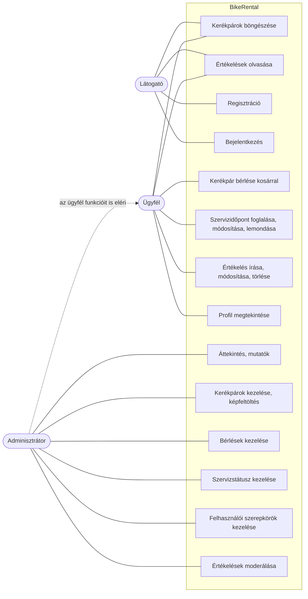

# Funkcionális specifikáció

## 1. A rendszer céljai és nem céljai

A fejlesztés célja a kerékpárkölcsönző számára egy webes rendszer, amely kiváltja a telefonos és papíralapú
bérlés- és szervizfoglalást, és egy helyen kezeli a flottát, a foglalásokat és az ügyfélvisszajelzéseket.

A rendszer két fő felhasználói csoportot szolgál ki. Az **ügyfelek** önállóan, a nap bármely szakában böngészhetik
a kínálatot, bérelhetnek kerékpárt, foglalhatnak szervizidőpontot és értékelhetik a szolgáltatást. Az
**adminisztrátorok** (a kölcsönző munkatársai) egy vezérlőpulton kezelik a kerékpárokat, a bérléseket, a
szervizfoglalásokat, a felhasználók jogosultságát, és moderálják az értékeléseket.

Fontos cél, hogy az ügyfél ne tudjon olyan kerékpárt lefoglalni, amely a választott időszakban már foglalt, illetve
ne foglalhasson olyan szervizsávot, amelyet más már lefoglalt. Ezt a kliens a naptárban jelzi, a szerver pedig minden
foglaláskor újra ellenőrzi.

A kerékpárkínálat és az értékelések bejelentkezés nélkül is elérhetők, hogy a leendő ügyfelek regisztráció előtt
tájékozódhassanak.

Az első ütemben **nem cél**:
- az online fizetés (a díjat a helyszínen fizetik, a rendszer csak kiszámolja),
- a kerékpárok fizikai átadásának és visszavételének rögzítése (átadás-átvételi lap),
- e-mail- vagy SMS-értesítés küldése,
- a jelszó-visszaállítás és a profiladatok módosítása,
- több telephely kezelése.

## 2. Használati esetek

A rendszer szereplői:
* látogató (nem bejelentkezett felhasználó)
* ügyfél (bejelentkezett, *Customer* szerepkörű felhasználó)
* adminisztrátor (bejelentkezett, *Admin* szerepkörű felhasználó)

A rendszernek a következő funkciókat kell ellátnia:
* a látogató böngészhesse a kerékpárokat és az értékeléseket, regisztrálhasson és bejelentkezhessen
* az ügyfél időszakot választhasson, a szabad kerékpárokat kosárba tehesse és lefoglalhassa
* az ügyfél szervizidőpontot foglalhasson, módosíthasson és mondhasson le
* az ügyfél értékelést írhasson, a sajátját módosíthassa és törölhesse
* az adminisztrátor kerékpárt vehessen fel képpel, módosíthasson, tilthasson le és törölhessen
* az adminisztrátor kezelhesse a bérléseket és a szervizfoglalások státuszát
* az adminisztrátor kezelhesse a felhasználók szerepkörét és moderálhassa az értékeléseket
* az adminisztrátor egy összesítő képernyőn lássa a fő mutatókat

Előfeltételek:
* bérléshez, szervizfoglaláshoz és értékeléshez regisztráció és bejelentkezés szükséges
* az adminisztrátori funkciókhoz *Admin* szerepkör szükséges; az első adminisztrátor fiókot a rendszer
  konfigurációból hozza létre, további adminisztrátort egy meglévő adminisztrátor jelölhet ki

## 3. Megfeleltetés, hogyan fedik le a használati esetek a követelményeket

* K01: A regisztráció, bejelentkezés és a profil használati esetei. A bejelentkezés JWT tokent ad, a menü és az
  elérhető oldalak a szerepkörtől függenek.
* K02: A kerékpárok böngészése bejelentkezés nélkül is működik, típus szerint szűrhető.
* K03: A bérlés használati esete: a naptárban választott időszak alapján csak a szabad kerékpárok jelennek meg,
  a kosár egy lépésben foglal le több kerékpárt, a szerver minden tételnél ellenőrzi az ütközést.
* K04: A szervizfoglalás használati esete: a szerver a nyitvatartás és a foglalások alapján számolja a szabad sávokat,
  egy sávra csak egy aktív foglalás lehet.
* K05: Az értékelés írása, módosítása, törlése, a nyilvános lista és összesítés, valamint az adminisztrátori moderálás.
* K06: Az adminisztrátor kerékpárkezelése képfeltöltéssel; bérléssel rendelkező kerékpár csak letiltható, nem törölhető.
* K07: A bérlések és szervizfoglalások adminisztrátori kezelése, a szervizstátuszok csak az engedélyezett sorrendben változhatnak.
* K08: Az adminisztrátori *Áttekintés* képernyő.
* K09: Jelszavak BCrypt hash-sel, tokenalapú hitelesítés, alapértelmezetten minden végpont hitelesítést kér, az
  adminisztrátori végpontok *Admin* szerepkört; a feltöltött képek formátumát a szerver a fájl tartalmából ellenőrzi.
* K10: Reszponzív React felület, a menü és az admin fülek mobilon tördelnek, a táblázatok vízszintesen görgethetők.
* K11: ASP.NET Core 10, React 19, Vite, SQLite – mind nyílt forráskódú, Windows, Linux és macOS alatt is futnak.
* K12: xUnit és Vitest tesztek, EF Core migrációk, GitHub Actions CI minden pushnál és pull requestnél.

## 4. Képernyőtervek

A képernyőtervek az elkészült alkalmazás oldalai. Az alkalmazás a `README.md` szerint indítható,
a felület a `http://localhost:5173` címen érhető el.

Útvonal|Oldal|Elérhetőség|Tartalom
-------|-----|-----------|--------
`/login`|Bejelentkezés|mindenki|E-mail, jelszó, hibaüzenet hibás adatoknál, link a regisztrációhoz.
`/register`|Regisztráció|mindenki|Felhasználónév (min. 3 karakter), e-mail, jelszó (min. 8 karakter), jelszó megerősítése, mezőnkénti hibaüzenetek.
`/`|Főoldal|ügyfél, admin|Személyes üdvözlés, kiemelt funkciók.
`/catalog`|Bicikli bérlés|mindenki (kosárba tenni csak bejelentkezve)|Típusszűrő, naptár a bérlési időszakhoz, kerékpárkártyák (kép, név, típus, napidíj, Kosárba gomb), kosár gomb a tételszámmal.
`/rental/:bikeId`|Foglalás egy kerékpárra|mindenki|Kerékpár adatai, foglalási űrlap név, e-mail, dátumokkal és a díj kiszámításával.
`/cart`|Kosár|ügyfél, admin|Tételek napszámmal és díjjal, tétel törlése, végösszeg, foglalás véglegesítése.
`/szerviz`|Szervizidőpont|ügyfél, admin|Havi naptár a szabad napok jelölésével, időpontrács, foglalási űrlap, saját foglalások listája módosítás és lemondás gombokkal.
`/ertekelesek`|Értékelések|mindenki (írni bejelentkezve)|Átlag és eloszlás, értékelő űrlap, saját értékelések, nyilvános lista szűréssel és lapozással, adminnak moderálás.
`/profile`|Profil|ügyfél, admin|Felhasználónév, e-mail, szerepkör, regisztráció dátuma, azonosító.
`/admin`|Admin vezérlőpult|admin|Fülek: Áttekintés, Biciklik, Kölcsönzések, Felhasználók, Szerviz.

A fejléc menüje bejelentkezés előtt: *Értékelések*, *Bejelentkezés*, *Fiók létrehozása*.
Bejelentkezés után: *Értékelések*, *Főoldal*, *Bérlés*, *Profil*, *Szerviz*, adminisztrátornak *Admin*, valamint *Kijelentkezés*.

## 5. Forgatókönyvek

**Látogatóként** az alkalmazás a bejelentkezési oldallal indul. A fejlécből elérhető az *Értékelések* oldal, ahol a
látogató látja az értékelések átlagát, a csillagonkénti eloszlást, és lapozhat a véleményekben. A *Fiók létrehozása*
gombbal regisztrálhat. Az űrlap a mezők elhagyásakor azonnal jelzi a hibákat (túl rövid felhasználónév vagy jelszó,
hibás e-mail, eltérő jelszavak). Már regisztrált e-mail-címmel a szerver elutasítja a regisztrációt, és ezt üzenetben
jelzi. Sikeres regisztráció után a felhasználó bejelentkezhet. Hibás e-mail vagy jelszó esetén a „Hibás email vagy
jelszó.” üzenet jelenik meg.

**Ügyfélként** bejelentkezve a *Főoldal* név szerint üdvözöl. A *Bérlés* menüpontban az ügyfél típus szerint szűrheti
a kerékpárokat, majd a naptárban kiválasztja a kezdő és a záró napot. A naptárban a múltbeli napok nem választhatók.
Időszak kiválasztása után csak azok a kerékpárok látszanak, amelyek a teljes időszakban szabadok. A letiltott
kerékpárok „Nem elérhető” jelzést kapnak, és nem tehetők kosárba. A *Kosárba* gomb időszak nélkül nem használható.
A kosárban az ügyfél látja a tételeket a napok számával, a díjjal és a végösszeggel, törölhet tételt, és egy gombbal
lefoglalja az összeset. Ha közben valaki más lefoglalta valamelyik kerékpárt, a szerver elutasítja az adott tételt,
a hibát az oldal kiírja, a sikertelen és a még fel nem dolgozott tételek a kosárban maradnak.

A *Szerviz* oldalon egy havi naptár jelöli a szabad időponttal rendelkező napokat. Nap választása után megjelennek az
órás sávok „Szabad” vagy „Foglalt” felirattal. Szabad sáv, kerékpártípus és kért szerviz megadásával (a hibaleírás
opcionális, legfeljebb 1000 karakter) az ügyfél lefoglalja az időpontot, amely „Visszaigazolásra vár” státuszba kerül.
Ha közben más foglalta le a sávot, a rendszer jelzi, és frissíti a naptárt. A *Saját foglalásaim* listában a jövőbeli,
függő vagy visszaigazolt foglalás módosítható (ekkor újra visszaigazolásra vár) vagy megerősítés után lemondható.

Az *Értékelések* oldalon az ügyfél 1–5 csillagot és opcionális, legfeljebb 2000 karakteres véleményt küldhet.
A saját értékeléseit módosíthatja és megerősítés után törölheti. A nyilvános listában a szerző felhasználóneve jelenik
meg, e-mail-cím vagy más személyes adat nem.

A *Profil* oldal a fiók adatait mutatja. A *Kijelentkezés* törli a tokent, és visszavisz a bejelentkezéshez. Lejárt
token (60 perc) esetén a rendszer automatikusan kijelentkezteti a felhasználót.

**Adminisztrátorként** a fejlécben megjelenik az *Admin* menüpont. Az *Áttekintés* fül kártyái a fő mutatókat mutatják,
kattintásra a megfelelő fülre visznek.

A *Biciklik* fülön új kerékpár vehető fel név, típus, napidíj és kép megadásával. A kép a *Kép tallózása…* gombbal
tölthető fel (JPG, PNG vagy WEBP, legfeljebb 5 MB), vagy kiválasztható a meglévő képek közül. A feltöltés után előnézet
jelenik meg. A táblázatban minden kerékpár szerkeszthető, letiltható vagy engedélyezhető, illetve megerősítés után
törölhető. Bérléssel rendelkező kerékpár törlését a rendszer elutasítja, és a letiltást javasolja.

A *Kölcsönzések* fülön a bérlések kerékpárra és időszakra szűrhetők. A lista a napok számát, a díjat és az állapotot
(*Közelgő*, *Folyamatban*, *Lezárult*) mutatja, a fejléc a darabszámot és a végösszeget. Bérlés megerősítés után törölhető.

A *Felhasználók* fülön az adminisztrátor kereshet név vagy e-mail szerint, és más felhasználónak admin jogot adhat vagy
elvehet. A saját jogát nem veheti el, így mindig marad legalább egy adminisztrátor. A változás a felhasználó következő
bejelentkezésekor lép életbe.

A *Szerviz* fülön a foglalások időszak és státusz szerint szűrhetők, a foglaló neve és e-mail-címe is látszik.
Függő foglalás visszaigazolható vagy lemondható, visszaigazolt foglalás lezárható (*Elkészült*) vagy lemondható.

Az értékelések moderálása az *Értékelések* oldalon történik, ahol az adminisztrátor bármely értékelést törölhet.

## 6. Funkció–követelmény megfeleltetés

ID|Verzió|Követelmény|Funkció
--|------|---|--------
K01|V1.0|Felhasználói fiókok kezelése|Regisztráció, bejelentkezés, kijelentkezés, profil; szerepkör szerinti menü és útvonalvédelem (`ProtectedRoute`, `AdminRoute`).
K02|V1.0|Nyilvános kerékpárkatalógus|*Bicikli bérlés* oldal típusszűréssel, bejelentkezés nélkül is.
K03|V1.0|Online kerékpárbérlés|Naptáras időszakválasztás, szabad kerékpárok szűrése, kosár, foglalás véglegesítése; szerveroldali ütközés- és dátumellenőrzés.
K04|V1.0|Szervizidőpont-foglalás|*Szerviz* oldal naptárral, időpontráccsal, saját foglalások módosításával és lemondásával.
K05|V1.0|Ügyfélértékelések|*Értékelések* oldal összesítéssel, szűréssel, lapozással, saját értékelések kezelésével, moderálással.
K06|V1.0|Flotta adminisztrációja|*Admin / Biciklik* fül: felvétel képfeltöltéssel, szerkesztés, letiltás, törlés.
K07|V1.0|Bérlések és szerviz adminisztrációja|*Admin / Kölcsönzések* és *Admin / Szerviz* fülek.
K08|V1.0|Vezérlőpult, kimutatások|*Admin / Áttekintés* fül.
K09|V1.0|Biztonság és adatvédelem|BCrypt jelszó-hash, JWT, alapértelmezett hitelesítési szabály, admin policy, képfájlok tartalmi ellenőrzése.
K10|V1.0|Egyszerű, reszponzív kezelőfelület|Magyar nyelvű React felület, reszponzív elrendezés 375 px szélességtől.
K11|V1.0|Platformfüggetlen, költséghatékony üzemeltetés|.NET 10, Node.js, SQLite, licencdíj nélkül.
K12|V1.0|Karbantarthatóság, bővíthetőség|Moduláris végpontok, EF Core migrációk, xUnit és Vitest tesztek, GitHub Actions CI.
