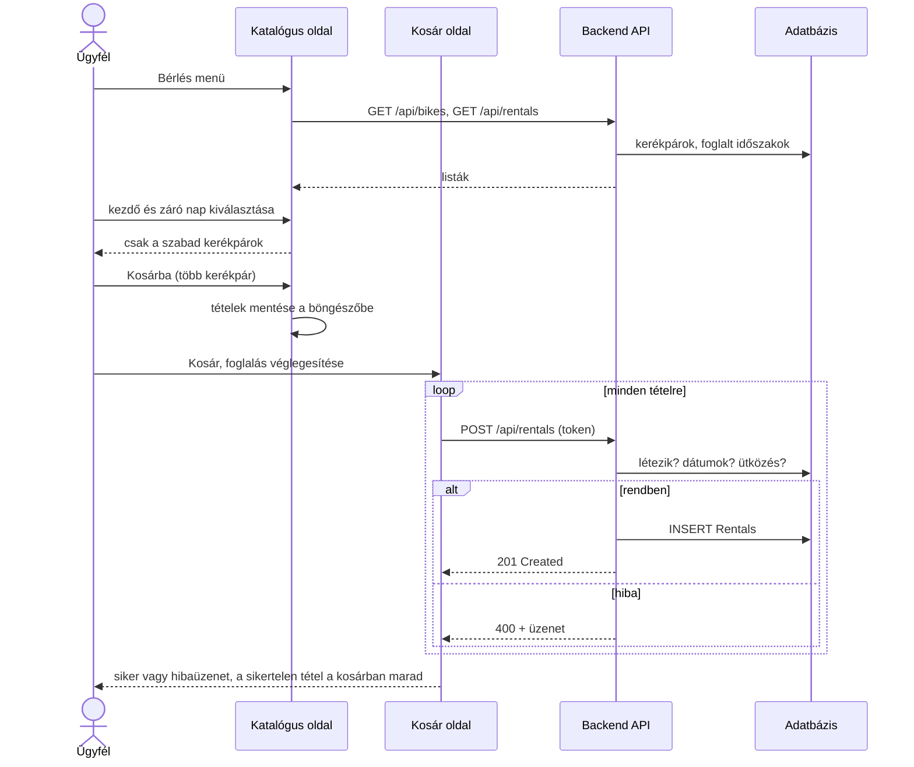
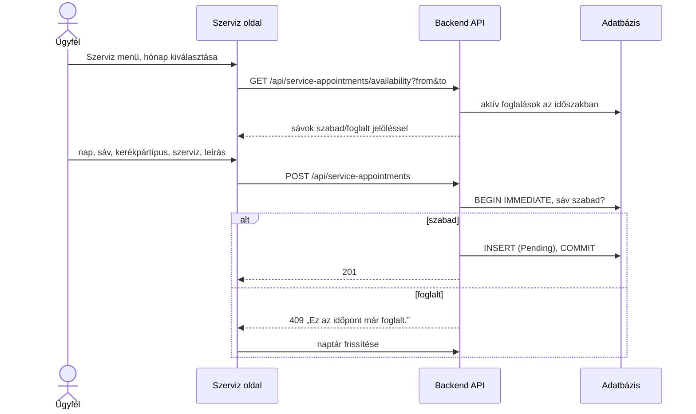
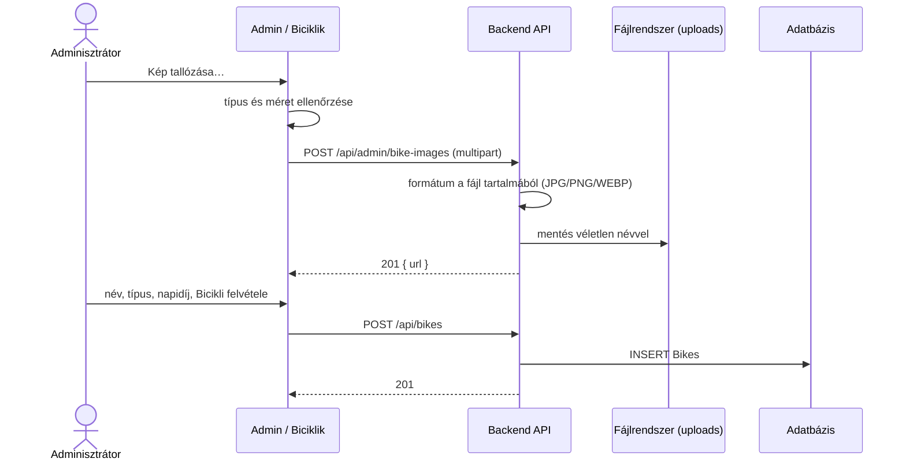
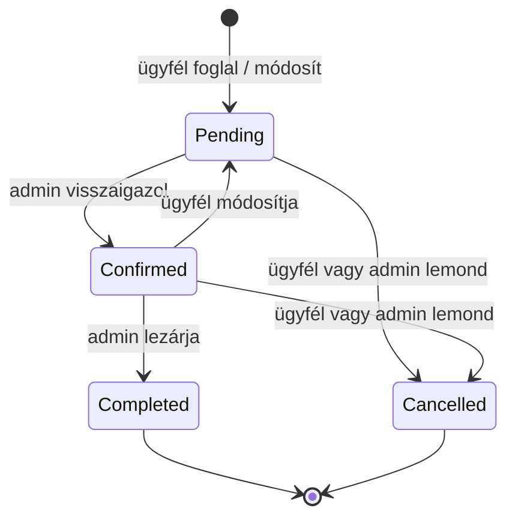
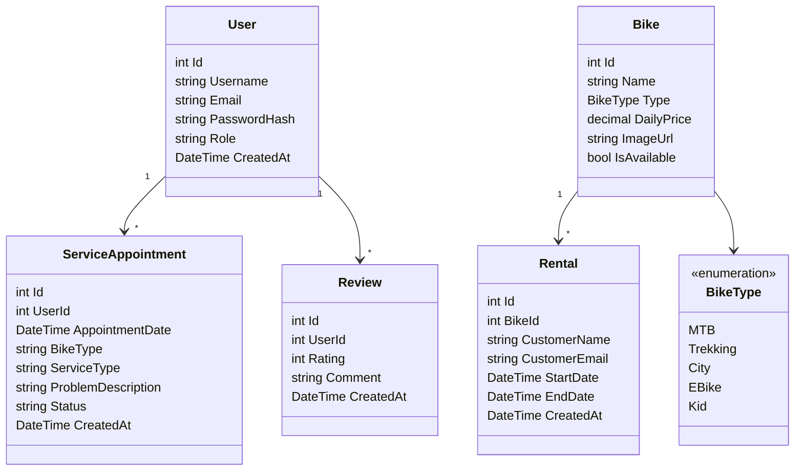
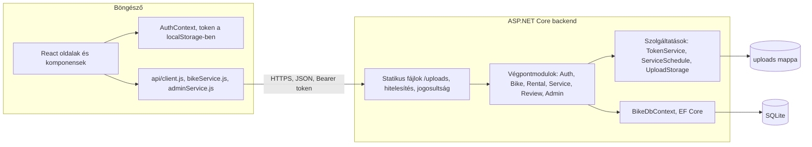
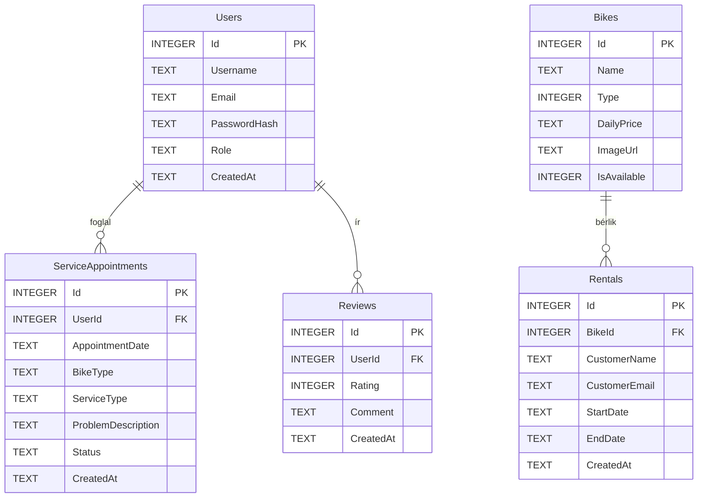

# Rendszerterv

## 1. A rendszer célja

A BikeRental egy webes kerékpárkölcsönző- és szervizrendszer. Az ügyfelek böngészőből választhatnak kerékpárt egy
időszakra, lefoglalhatják, szervizidőpontot foglalhatnak és értékelhetik a szolgáltatást. A kölcsönző munkatársai
adminisztrátorként kezelik a flottát, a bérléseket, a szervizfoglalásokat, a felhasználói jogosultságokat és az
értékeléseket, és egy vezérlőpulton követik a fő mutatókat.

A rendszer a foglalások ütközésmentességét szerveroldalon garantálja, a személyes adatokat csak a jogosultak láthatják,
és a felület asztali gépen és mobiltelefonon egyaránt használható.

## 2. Projektterv

### 2.1 Projektszerepkörök, felelősségek

Scrum master: *(kitöltendő)*
Feladata a sprintek szervezése, a napi egyeztetések vezetése, az akadályok feltárása és elhárítása.

Product owner: *(kitöltendő)*
Feladata a prioritással és üzleti értékkel ellátott felhasználói sztorikat tartalmazó Product Backlog vezetése.

Üzleti szereplők (Stakeholders):
- Megrendelő: a kerékpárkölcsönző és -szerviz tulajdonosa.
- Felhasználók: a kölcsönző ügyfelei és munkatársai.

### 2.2 Projektmunkások és felelősségeik

A felelősségi területek a verziókezelő történetéből (commitok) állnak össze.

Frontend:
- Mester Ottó – bejelentkezés, regisztráció, főoldal, profil, adminisztrátori vezérlőpult
- Rácz Roland – szervizidőpont-foglaló felület, értékelések felülete
- Ati *(GitHub: atimaki, teljes név kitöltendő)* – kerékpárkatalógus, foglalási oldal, kosár, fejléc, kerékpárképek

Backend:
- Mester Ottó – projektváz, adatbázis, JWT-hitelesítés, adminisztrátori végpontok, képfeltöltés
- Rácz Roland – szervizidőpont-foglalás, értékelések, kapcsolódó migrációk
- Ati – kerékpár- és bérlési tábla, kerékpár- és bérlési végpontok, seed adatok

Tesztelés:
- Mester Ottó – hitelesítés és adminisztráció tesztjei
- Rácz Roland – értékelések és migrációk tesztjei
- Ati – kerékpár- és bérlési tesztek, katalógus és kosár frontendtesztjei

### 2.3 Ütemterv

||Funkció / Story|Feladat / Task|Felelős|Kezdés|Befejezés|Állapot||
|-|---------------|--------------|-------|------|---------|-------|-|
||Projektalap|Minimal API, adatbázis, projektszerkezet|Mester Ottó|2026.10.17.|2026.10.17.|kész||
||Hitelesítés|JWT bejelentkezés, auth middleware|Mester Ottó|2026.10.19.|2026.10.19.|kész||
||Hitelesítés|Bejelentkezés és regisztráció React oldal|Mester Ottó|2026.10.19.|2026.10.19.|kész||
||Website|Főoldal és profil oldal|Mester Ottó|2026.10.20.|2026.10.20.|kész||
||Adattárolás|Szerviz és értékelés táblák|Rácz Roland|2026.11.01.|2026.11.01.|kész||
||Szerviz|Időpontfoglalás backend és felület|Rácz Roland|2026.11.03.|2026.11.03.|kész||
||Projektalap|Repo rendbetétel, dokumentáció, CI|Mester Ottó|2026.11.03.|2026.11.03.|kész||
||Katalógus|Kerékpár tábla, seed, szűrés, admin végpontok|Ati|2026.11.08.|2026.11.08.|kész||
||Bérlés|Bérlési tábla, végpontok, tesztek, katalógus és foglalási oldal|Ati|2026.11.08.|2026.11.08.|kész||
||Értékelés|Értékelési rendszer backend és frontend|Rácz Roland|2026.11.09.|2026.11.09.|kész||
||Bérlés|Kosár alapú foglalási folyamat, dizájn|Ati|2026.11.10.|2026.11.11.|kész||
||Adminisztráció|Admin végpontok, admin vezérlőpult, képfeltöltés|Mester Ottó|2026.11.11.|2026.11.11.|kész||
||Dokumentáció|Követelmény- és funkcionális specifikáció, rendszerterv, tesztjegyzőkönyvek|Mester Ottó|2026.11.11.|2026.11.11.|kész||
||Hibajavítás|Bérlési végpontok jogosultságkezelése, RentalTests javítása|*(kitöltendő)*|–|–|nyitott||

### 2.4 Mérföldkövek

- Hitelesítés és alap felület (bejelentkezés, regisztráció, profil) – 2026.10.20.
- Szervizfoglalás és értékelések – 2026.11.09.
- Bérlési folyamat kosárral – 2026.11.11.
- Adminisztrátori vezérlőpult – 2026.11.11.
- Az elkészült szoftver átadása – *(kitöltendő)*

## 3. Üzleti folyamatok modellje

### 3.1 Üzleti szereplők

A rendszer bejelentkezés nélkül is használható korlátozottan: a látogató böngészheti a kerékpárokat és az
értékeléseket, regisztrálhat és bejelentkezhet.
Regisztrált üzleti szereplő az **ügyfél** (*Customer* szerepkör) és az **adminisztrátor** (*Admin* szerepkör).
Regisztrációkor mindenki ügyfél lesz; adminisztrátorrá egy meglévő adminisztrátor léptethet elő valakit.
Az első adminisztrátor fiókot a rendszer a konfigurációból hozza létre.

### 3.2 Üzleti folyamatok

Bejelentkezés mindenki számára ugyanolyan lefutású:
A *Bejelentkezés* oldalon a felhasználó megadja az e-mail-címét és a jelszavát, majd a *Bejelentkezés* gombra kattint.
Sikeres azonosítás után a rendszer 60 percig érvényes tokent ad ki, és megjelenik a szerepkörnek megfelelő menü.
Sikertelen azonosításnál a „Hibás email vagy jelszó.” üzenet jelenik meg.

#### Üzleti folyamatok látogatók számára:
- Regisztráció: a *Fiók létrehozása* gombra kattintva megjelenik az űrlap. A mezők elhagyásakor azonnali ellenőrzés fut.
  Helyes adatoknál a *Regisztráció* gombbal a felhasználó létrejön *Customer* szerepkörrel.

||Űrlap mező|Követelmények||
|-|----------|-------------|-|
||Felhasználónév|1. Kötelező 2. Legalább 3 karakter||
||E-mail-cím|1. Kötelező 2. Érvényes e-mail formátum 3. Nem lehet már regisztrált cím||
||Jelszó|1. Kötelező 2. Legalább 8 karakter||
||Jelszó megerősítése|1. Kötelező 2. Egyezzen a jelszóval||

- Kerékpárok böngészése: a *Bicikli bérlés* oldalon a kerékpárok kártyákon jelennek meg képpel, névvel, típussal
  és napidíjjal. Típus szerint szűrhetők.
- Értékelések olvasása: az *Értékelések* oldalon az átlag, a csillagonkénti eloszlás és a lapozható lista látható.

#### Üzleti folyamatok ügyfelek számára:
- Kerékpárbérlés: a *Bérlés* menüben az ügyfél a naptárban kiválasztja a kezdő és a záró napot. A lista ekkor csak a
  teljes időszakban szabad kerékpárokat mutatja. A *Kosárba* gombbal tételt ad a kosárhoz (ugyanaz a kerékpár csak
  egyszer szerepelhet, újbóli hozzáadáskor az időszak felülíródik). A *Kosár* oldalon a tételek a napok számával és a
  díjjal, alul a végösszeggel jelennek meg. A véglegesítéskor a rendszer tételenként foglal, és a szerver minden tételnél
  ellenőrzi:

||Ellenőrzés|Hibaüzenet||
|-|----------|----------|-|
||A kerékpár létezik|„A megadott bicikli nem létezik.”||
||Kezdő dátum a záró előtt van|„A kezdési dátum előbb kell legyen, mint a befejezési dátum.”||
||A kezdő dátum nem múltbeli|„A kezdési dátum nem lehet a múltban.”||
||Nincs átfedő foglalás|„Az adott bicikli már foglalt ebben az időszakban.”||

- Szervizidőpont foglalása: a *Szerviz* oldalon az ügyfél kiválasztja a napot és a szabad sávot, megadja az adatokat,
  majd a *Időpont lefoglalása* gombra kattint. A foglalás *Függő* státuszba kerül.

||Űrlap mező|Követelmények||
|-|----------|-------------|-|
||Időpont|1. Kötelező 2. Jövőbeli, munkanapra eső, 9–17 óra közötti, 60 perces sáv kezdete 3. Legfeljebb 90 nappal előre 4. Nem lehet más aktív foglalása||
||Kerékpár típusa|1. Kötelező 2. Legfeljebb 100 karakter||
||Kért szerviz|1. Kötelező 2. Legfeljebb 100 karakter||
||Probléma leírása|1. Opcionális 2. Legfeljebb 1000 karakter||

- Szervizfoglalás módosítása: jövőbeli, *Függő* vagy *Visszaigazolt* foglalásnál a *Módosítás* gomb az űrlapba tölti
  az adatokat; mentés után a foglalás újra *Függő* lesz.
- Szervizfoglalás lemondása: jövőbeli, *Függő* vagy *Visszaigazolt* foglalásnál a *Lemondás* gomb, megerősítés után
  *Lemondva* státusz.
- Értékelés írása: csillag (1–5) és opcionális vélemény (legfeljebb 2000 karakter, szélső szóközök nélkül tárolva).
- Saját értékelés módosítása és törlése (megerősítéssel).
- Profil megtekintése: felhasználónév, e-mail, szerepkör, regisztráció dátuma, azonosító.

#### Üzleti folyamatok adminisztrátorok számára:
Az adminisztrátor az ügyfél minden funkcióját eléri, továbbá:
- Kerékpár felvétele:

||Űrlap mező|Követelmények||
|-|----------|-------------|-|
||Név|1. Kötelező 2. Legfeljebb 100 karakter||
||Típus|1. Kötelező 2. MTB, Trekking, City, E-Bike vagy Gyerek||
||Napidíj (Ft)|1. Kötelező 2. Pozitív, legfeljebb 999 999,99||
||Kép|1. Kötelező 2. Feltöltött JPG, PNG vagy WEBP fájl, legfeljebb 5 MB, vagy meglévő kép útvonala||

- Kerékpár módosítása: a fenti mezők és az *Elérhető kölcsönzésre* jelölő.
- Kerékpár letiltása / engedélyezése egy kattintással.
- Kerékpár törlése: csak akkor, ha nincs hozzá bérlés; különben letiltást kell alkalmazni.
- Bérlések listázása kerékpár és időszak szerinti szűréssel, végösszeggel; bérlés törlése.
- Szervizfoglalás státuszának módosítása:

||Jelenlegi státusz|Lehetséges új státusz||
|-|-----------------|---------------------|-|
||Függő (Pending)|Visszaigazolt (Confirmed), Lemondva (Cancelled)||
||Visszaigazolt (Confirmed)|Elkészült (Completed), Lemondva (Cancelled)||
||Elkészült, Lemondva|–||

- Felhasználó előléptetése adminisztrátorrá vagy admin jog elvétele (a sajátját nem veheti el).
- Értékelés moderálása (törlés).

### 3.3 Üzleti entitások

- kerékpár
- bérlés
- szervizfoglalás
- értékelés
- felhasználó

## 4. Követelmények

### 4.1 Funkcionális követelmények

* Látogatókra vonatkozó követelmények
  A látogató regisztráció nélkül láthatja a kerékpárkínálatot és az értékeléseket. Foglalni, értékelni csak
  bejelentkezve lehet. Más felhasználók személyes adataihoz (e-mail, foglalások) nem férhet hozzá.

* Ügyfelekre vonatkozó követelmények
  Az ügyfél kerékpárt bérelhet egy vagy több kerékpárra egyszerre, szervizidőpontot foglalhat, módosíthat, lemondhat,
  értékelést írhat, módosíthat, törölhet. Csak a saját szervizfoglalásait és saját értékeléseit kezelheti.

* Adminisztrátorokra vonatkozó követelmények
  Az adminisztrátor kezeli a flottát (felvétel képfeltöltéssel, módosítás, letiltás, törlés), a bérléseket, a
  szervizfoglalások státuszát, a felhasználók szerepkörét, és moderálja az értékeléseket. Az összesítő képernyőn
  látja a flotta, a bérlések, a bevétel, a függő szervizek és az értékelések mutatóit.

### 4.2 Nemfunkcionális követelmények

* Termék követelmények
  * Használhatósági követelmények
    Magyar nyelvű, egyértelmű feliratokkal ellátott felület; az űrlapok azonnal jelzik a hibákat; minden törlés és
    lemondás megerősítést kér; a felület 375 px szélességtől vízszintes görgetés nélkül használható.
  * Megbízhatósági követelmények
    A szervizfoglalás ellenőrzése és írása egy azonnali (IMMEDIATE) SQLite tranzakcióban fut, így egyidejű kérések
    sem foglalhatják le kétszer ugyanazt a sávot. A szervizstátusz-váltás és a lemondás feltételes UPDATE-tel atomi.
    Az adatbázis CHECK-feltételekkel és idegen kulcsokkal védi az adatok épségét.
  * Hatékonysági követelmények
    * Teljesítmény követelmények
      Egy kölcsönző néhány tucat kerékpárral és legfeljebb néhány ezer ügyféllel: az SQLite és a Kestrel szerver ezt
      bőven kiszolgálja. Az értékelések lapozva (oldalanként legfeljebb 100) töltődnek.
    * Méret követelmények
      A kliens buildje kb. 330 kB JavaScript (tömörítve kb. 100 kB). A feltöltött képek egyenként legfeljebb 5 MB-osak.
  * Hordozhatósági követelmények
    A backend Windows, Linux és macOS alatt fut (.NET 10), a kliens bármely modern böngészőben.

* Szervezeti követelmények
  * Szállítási követelmények
    A forráskód a GitHub repóban (`reaperfan/BikeRentalApp`) érhető el; a változások a `dev` ágra kerülnek, a CI a
    buildet és a teszteket minden pushnál és pull requestnél lefuttatja.
  * Implementációs követelmények
    A telepítés a `README.md` szerint történik. Fejlesztői módban az adatbázis-migrációk és a kezdő admin fiók
    automatikusan létrejönnek, a 15 mintakerékpár seed adatként kerül be.
  * Szabványügyi követelmények
    A vonatkozó szabványok a *Törvényi előírások, szabványok* fejezetben találhatók.

* Külső követelmények
  * Együttműködési követelmények
    A csapat a GitHub repón (commitok, issue-k) keresztül egyeztet.
  * Jogi követelmények
    * Titokvédelmi követelmények
      A JWT aláíró kulcs nem kerülhet a verziókezelőbe; fejlesztői gépen a gitignore-olt `appsettings.Development.json`
      tartalmazza.
    * Biztonsági követelmények
      Jelszavak BCrypt hash-sel; tokenalapú hitelesítés, 60 perces lejárattal; alapértelmezésben minden végpont
      hitelesítést kér, a nyilvános végpontok kifejezetten jelöltek; az adminisztrátori végpontok *Admin* szerepkört
      kérnek; a feltöltött fájlok formátumát a szerver a tartalom alapján ellenőrzi, a fájlnevet véletlenszerűen generálja.

### 4.3 Törvényi előírások, szabványok

Az EU 2016/679 rendelet (GDPR) és a 2011. évi CXII. törvény (Infotv.) a felhasználók személyes adatainak (név,
e-mail, foglalások) kezelése miatt.

A 2013. évi V. törvény (Ptk.) a bérleti és vállalkozási (szerviz) szerződés szabályai miatt.

Az 1997. évi CLV. törvény a fogyasztóvédelemről, a 45/2014. (II. 26.) Korm. rendelet a fogyasztó és a vállalkozás
közötti szerződésekről, valamint a 2001. évi CVIII. törvény az elektronikus kereskedelmi szolgáltatásokról.

Az EU 2019/882 irányelv és a WCAG 2.1 AA ajánlás a felület akadálymentessége miatt.

Az ISO/IEC 25010 a szoftvertermék minőségi jellemzőiről, az ISO/IEC/IEEE 12207 a szoftveréletciklus-folyamatokról.

Az OWASP Top 10 és OWASP ASVS a webalkalmazás biztonsági követelményeiről, az RFC 7519 a JWT formátumáról.

## 5. Funkcionális terv

### 5.1 Rendszerszereplők

A rendszerben három szereplő van. A **látogató** a nyilvános tartalmakat látja. Az **ügyfél** bérel, szervizt foglal
és értékel, de csak a saját adatait kezelheti. Az **adminisztrátor** a kölcsönző munkatársa: az ügyfél funkcióin
felül teljes hozzáféréssel kezeli a flottát, a foglalásokat és a felhasználókat. A szerepkört a `Users` tábla
`Role` mezője tárolja, és a bejelentkezéskor kiadott token tartalmazza.

### 5.2 Rendszerhasználati esetek és lefutásaik

**Kerékpárbérlés kosárral**



**Szervizidőpont foglalása**



**Kerékpár felvétele képfeltöltéssel (adminisztrátor)**



**Szervizstátusz kezelése (adminisztrátor)**



### 5.3 Határ osztályok

A határosztályok a felhasználói felület React oldalai és komponensei, valamint a backend végpontcsoportjai.

#### A látogató és az ügyfél tevékenységeihez kapcsolódó határosztályok

Osztály|Fájl|Szerep
-------|----|------
Login|`Frontend/src/pages/Login.jsx`|Bejelentkezési űrlap
Register|`Frontend/src/pages/Register.jsx`|Regisztrációs űrlap ellenőrzéssel
Home|`Frontend/src/pages/Home.jsx`|Főoldal
Profile|`Frontend/src/pages/Profile.jsx`|Profiladatok
BikeCatalog|`Frontend/src/pages/BikeCatalog.jsx`|Kerékpárlista, szűrés, időszakválasztás, kosárba tétel
BikeCard|`Frontend/src/components/BikeCard.jsx`|Egy kerékpár kártyája
DateRangeCalendar|`Frontend/src/components/DateRangeCalendar.jsx`|Időszakválasztó naptár foglalt napokkal
BikeRental|`Frontend/src/pages/BikeRental.jsx`|Egy kerékpár foglalási űrlapja
RentalCart|`Frontend/src/pages/RentalCart.jsx`|Kosár és foglalás véglegesítése
Service|`Frontend/src/pages/Szerviz.jsx`|Szerviznaptár, foglalás, saját foglalások
Reviews|`Frontend/src/pages/Reviews.jsx`|Értékelések összesítése, írása, listája, moderálása
AppHeader|`Frontend/src/components/AppHeader.jsx`|Szerepkör szerinti menü

#### Az adminisztrátor tevékenységeihez kapcsolódó határosztályok

Osztály|Fájl|Szerep
-------|----|------
Admin|`Frontend/src/pages/Admin.jsx`|Fülkezelő vezérlőpult
AdminOverview|`Frontend/src/pages/admin/AdminOverview.jsx`|Mutatók
AdminBikes|`Frontend/src/pages/admin/AdminBikes.jsx`|Kerékpárkezelés, képfeltöltés
AdminRentals|`Frontend/src/pages/admin/AdminRentals.jsx`|Bérléskezelés
AdminUsers|`Frontend/src/pages/admin/AdminUsers.jsx`|Szerepkörkezelés
AdminService|`Frontend/src/pages/admin/AdminService.jsx`|Szervizstátusz-kezelés
AdminRoute|`Frontend/src/auth/AdminRoute.jsx`|Csak adminisztrátornak engedi az útvonalat

#### Backend végpontcsoportok (szerveroldali határosztályok)

Osztály|Útvonal|Fájl
-------|-------|----
AuthEndpoints|`/api/auth`|`Backend/Endpoints/AuthEndpoints.cs`
BikeEndpoints|`/api/bikes`|`Backend/Endpoints/BikeEndpoints.cs`
RentalEndpoints|`/api/rentals`|`Backend/Endpoints/RentalEndpoints.cs`
ServiceAppointmentEndpoints|`/api/service-appointments`|`Backend/Endpoints/ServiceAppointmentEndpoints.cs`
ReviewEndpoints|`/api/reviews`|`Backend/Endpoints/ReviewEndpoints.cs`
AdminEndpoints|`/api/admin`|`Backend/Endpoints/AdminEndpoints.cs`

### 5.4 Menühierarchiák

A menü a fejlécben, vízszintes sávként jelenik meg; keskeny képernyőn több sorba tördel.

Bejelentkezés előtt: *Értékelések*, *Bejelentkezés*, *Fiók létrehozása*.

**Ügyfélként** bejelentkezve: *Értékelések*, *Főoldal*, *Bérlés*, *Profil*, *Szerviz*, *Kijelentkezés*.
A *Bérlés* oldalon a *Kosár* gomb vezet a kosárhoz.

**Adminisztrátorként** bejelentkezve a fentiek mellett megjelenik az *Admin* menüpont, amelyen belül a fülek:
*Áttekintés*, *Biciklik*, *Kölcsönzések*, *Felhasználók*, *Szerviz*. Az értékelések moderálására az *Admin*
oldal fejlécében egy link mutat.

### 5.5 Képernyőtervek

A képernyőtervek az elkészült alkalmazás oldalai, leírásuk a funkcionális specifikáció *4. Képernyőtervek* fejezetében
található. A felület egységes színvilágú (sötétzöld, lime és pasztell kártyák), kártyás elrendezésű, minden oldal
fejléce egy rövid felső címkét, nagy címet és egy egysoros leírást tartalmaz.

## 6. Fizikai környezet

### 6.1 Vásárolt softwarekomponensek és külső rendszerek

Nincsenek vásárolt szoftverkomponensek. Felhasznált nyílt forráskódú csomagok:

Csomag|Szerep
------|------
ASP.NET Core 10 Minimal API|Webszerver, végpontok
Entity Framework Core 10 + SQLite provider|Adatelérés, migrációk
Microsoft.AspNetCore.Authentication.JwtBearer|Tokenalapú hitelesítés
BCrypt.Net-Next|Jelszó-hash
Swashbuckle (Swagger UI)|API-dokumentáció fejlesztői módban
React 19, React Router 7|Kliens
Vite 8|Fejlesztői szerver, build
Vitest, Testing Library, jsdom|Frontendtesztek
xUnit, Microsoft.AspNetCore.Mvc.Testing|Backendtesztek
oxlint|JavaScript lint

### 6.2 Hardver és hálózati topológia

- Az alkalmazás webes platformra készül, böngészőből érhető el.
- A backend egy HTTP API-t szolgáltat (`/api`), és kiszolgálja a feltöltött képeket (`/uploads`).
- A kliens statikus fájlok (HTML, JS, CSS, képek) formájában kerül a felhasználóhoz.
- Fejlesztéskor a Vite szerver (5173-as port) a `/api` és `/uploads` kéréseket a backendre (5006-os port) továbbítja,
  így nincs szükség CORS-beállításra.

### 6.3 Fizikai alrendszerek

- Webszerver: Kestrel (ASP.NET Core), éles környezetben HTTPS-sel, fordított proxy (pl. nginx, IIS) mögött is futtatható.
- Adatbázis: SQLite fájl (`bikerental.db`) a backend mellett.
- Fájltár: a feltöltött képek a `Backend/uploads/bikes` mappában.
- Kliens gépek: modern böngészőt futtató PC-k, laptopok, mobiltelefonok.

### 6.4 Fejlesztő eszközök

- Visual Studio 2026 / Visual Studio Code
- .NET 10 SDK, `dotnet-ef` parancssori eszköz
- Node.js 22+ és npm
- Git, GitHub, GitHub Actions
- Swagger UI az API kipróbálásához
- Claude Code (kódgenerálás, kódátnézés, dokumentáció)

## 7. Absztrakt domain modell



A bérlés nem idegen kulccsal, hanem a foglaló nevével és e-mail-címével kapcsolódik a felhasználóhoz.

## 8. Architekturális terv

A rendszer kliens–szerver felépítésű. A böngészőben futó React egyoldalas alkalmazás (SPA) JSON-alapú REST API-n
keresztül kommunikál az ASP.NET Core backenddel, amely Entity Framework Core-ral éri el az SQLite adatbázist.

### 8.1 Architekturális tervezési minta

- Backend: Minimal API, funkcionális modulokra bontva (`Endpoints/*Endpoints.cs`), mindegyik egy bővítő metódussal
  regisztrálja a saját útvonalcsoportját. A modulok DTO-kon (`Dtos/`) keresztül kommunikálnak, az entitások (`Model/`)
  nem kerülnek ki közvetlenül.
- Frontend: komponensalapú React, a szerverhívások szolgáltatásmodulokban (`api/`) vannak, a hitelesítési állapotot
  egy React Context (`AuthContext`) kezeli.

### 8.2 Az alkalmazás rétegei, fő komponensei, ezek kapcsolatai



**REST API végpontok**

Metódus|Útvonal|Jogosultság|Leírás
-------|-------|-----------|------
POST|`/api/auth/register`|nyilvános|Regisztráció
POST|`/api/auth/login`|nyilvános|Bejelentkezés, token
GET|`/api/auth/me`|bejelentkezett|Saját adatok
GET|`/api/bikes`|nyilvános|Kerékpárok (`type`, `available` szűrő)
GET|`/api/bikes/{id}`|nyilvános|Egy kerékpár
POST|`/api/bikes`|admin|Kerékpár felvétele
PUT|`/api/bikes/{id}`|admin|Kerékpár módosítása
DELETE|`/api/bikes/{id}`|admin|Kerékpár törlése (409, ha van bérlése)
GET|`/api/rentals`|nyilvános|Bérlések (a katalógus foglalt napjaihoz)
GET|`/api/rentals/{id}`, `/api/rentals/bike/{bikeId}`|nyilvános|Egy bérlés, egy kerékpár bérlései
POST|`/api/rentals`|bejelentkezett|Bérlés létrehozása
PUT, DELETE|`/api/rentals/{id}`|nyilvános *(ismert hiba, lásd 11. fejezet)*|Bérlés módosítása, törlése
GET|`/api/service-appointments/availability`|bejelentkezett|Szabad sávok (`from`, `to`, max. 31 nap)
GET, POST|`/api/service-appointments`|bejelentkezett|Saját foglalások, új foglalás
PUT, DELETE|`/api/service-appointments/{id}`|bejelentkezett (saját)|Módosítás, lemondás
GET|`/api/service-appointments/admin`|admin|Foglalások időszakra
PATCH|`/api/service-appointments/admin/{id}/status`|admin|Státuszváltás
GET|`/api/reviews`, `/api/reviews/summary`, `/api/reviews/{id}`|nyilvános|Lista, összesítés, egy értékelés
GET|`/api/reviews/mine`|bejelentkezett|Saját értékelések
POST|`/api/reviews`|bejelentkezett|Értékelés
PUT, DELETE|`/api/reviews/{id}`|bejelentkezett (saját)|Módosítás, törlés
DELETE|`/api/reviews/admin/{id}`|admin|Moderálás
GET|`/api/admin/stats`|admin|Mutatók
GET|`/api/admin/users`|admin|Felhasználók
PATCH|`/api/admin/users/{id}/role`|admin|Szerepkör módosítása
GET|`/api/admin/rentals`|admin|Bérlések végösszeggel (`bikeId`, `from`, `to`)
DELETE|`/api/admin/rentals/{id}`|admin|Bérlés törlése
POST|`/api/admin/bike-images`|admin|Képfeltöltés (multipart, `file`)

A hibák egységesen `{ "message": "…" }` formában érkeznek, magyar nyelvű szöveggel.

### 8.3 Változások kezelése

- Kód: Git, a közös fejlesztési ág a `dev`; a GitHub Actions CI minden pushnál és pull requestnél lefuttatja a
  backend buildet és teszteket, valamint a frontend lintet és buildet.
- Adatbázis: minden sémaváltozás EF Core migráció (`Backend/Migrations`). Fejlesztői módban a backend induláskor
  automatikusan alkalmazza a migrációkat, éles környezetben a `dotnet ef database update` külön telepítési lépés.
- A kliens oldalon nincs telepítendő komponens; új verziónál a böngésző a friss statikus fájlokat tölti le.

## 9. Adatbázisterv

**Felhasználó (Users)** egyed: Id (elsődleges kulcs), felhasználónév, e-mail-cím, jelszó-hash, szerepkör
(*Customer* vagy *Admin*), regisztráció időpontja.

**Kerékpár (Bikes)** egyed: Id, név, típus (0–4), napidíj, kép elérési útja, elérhető-e.

**Bérlés (Rentals)** egyed: Id, kerékpár (idegen kulcs, törlés tiltva), foglaló neve, e-mail-címe, kezdő és záró
időpont, létrehozás időpontja.

**Szervizfoglalás (ServiceAppointments)** egyed: Id, felhasználó (idegen kulcs, kaszkád törlés), időpont (UTC),
kerékpártípus, kért szerviz, hibaleírás, státusz, létrehozás időpontja.

**Értékelés (Reviews)** egyed: Id, felhasználó (idegen kulcs, kaszkád törlés), pontszám (1–5), vélemény
(legfeljebb 2000 karakter), létrehozás időpontja.

### 9.1 Logikai adatmodell

### Egyed-Kapcsolat diagram



### Adatbázis séma

Tábla|Mező|Típus|Megkötés
-----|----|-----|--------
Users|Id|INTEGER|PK, autoincrement
Users|Username|TEXT|NOT NULL
Users|Email|TEXT|NOT NULL (egyediségét az alkalmazás ellenőrzi)
Users|PasswordHash|TEXT|NOT NULL, BCrypt
Users|Role|TEXT|NOT NULL, `Customer` vagy `Admin`
Users|CreatedAt|TEXT|NOT NULL, UTC
Bikes|Id|INTEGER|PK, autoincrement
Bikes|Name|TEXT|NOT NULL
Bikes|Type|INTEGER|NOT NULL, 0 MTB, 1 Trekking, 2 City, 3 EBike, 4 Kid
Bikes|DailyPrice|TEXT|NOT NULL, decimal
Bikes|ImageUrl|TEXT|NOT NULL
Bikes|IsAvailable|INTEGER|NOT NULL, 0/1
Rentals|Id|INTEGER|PK, autoincrement
Rentals|BikeId|INTEGER|FK → Bikes.Id, ON DELETE RESTRICT, index
Rentals|CustomerName, CustomerEmail|TEXT|NOT NULL
Rentals|StartDate, EndDate, CreatedAt|TEXT|NOT NULL
ServiceAppointments|Id|INTEGER|PK, autoincrement
ServiceAppointments|UserId|INTEGER|FK → Users.Id, ON DELETE CASCADE, index
ServiceAppointments|AppointmentDate|TEXT|NOT NULL, UTC
ServiceAppointments|BikeType, ServiceType|TEXT|NOT NULL, max. 100
ServiceAppointments|ProblemDescription|TEXT|NULL, max. 1000
ServiceAppointments|Status|TEXT|NOT NULL, max. 30
ServiceAppointments|CreatedAt|TEXT|NOT NULL
Reviews|Id|INTEGER|PK, autoincrement
Reviews|UserId|INTEGER|FK → Users.Id, ON DELETE CASCADE, index
Reviews|Rating|INTEGER|NOT NULL, CHECK 1–5
Reviews|Comment|TEXT|NULL, CHECK max. 2000
Reviews|CreatedAt|TEXT|NOT NULL

### 9.2 Tárolt eljárások

Nincsenek tárolt eljárások. Az üzleti logika a backendben fut, az adatbázis-műveleteket az EF Core LINQ lekérdezései
és feltételes `ExecuteUpdate` / `ExecuteDelete` utasításai végzik.

### 9.3 Fizikai adatmodellt legeneráló SQL szkript

A sémát az EF Core migrációk hozzák létre (`dotnet ef database update`). Az alábbi szkript a migrációk lefutása utáni
végső séma, egy friss adatbázisból kiolvasva.

```sql
CREATE TABLE "Users" (
    "Id" INTEGER NOT NULL CONSTRAINT "PK_Users" PRIMARY KEY AUTOINCREMENT,
    "Username" TEXT NOT NULL,
    "Email" TEXT NOT NULL,
    "PasswordHash" TEXT NOT NULL,
    "Role" TEXT NOT NULL,
    "CreatedAt" TEXT NOT NULL
);

CREATE TABLE "Bikes" (
    "Id" INTEGER NOT NULL CONSTRAINT "PK_Bikes" PRIMARY KEY AUTOINCREMENT,
    "Name" TEXT NOT NULL,
    "Type" INTEGER NOT NULL,
    "DailyPrice" TEXT NOT NULL,
    "ImageUrl" TEXT NOT NULL,
    "IsAvailable" INTEGER NOT NULL
);

CREATE TABLE "Rentals" (
    "Id" INTEGER NOT NULL CONSTRAINT "PK_Rentals" PRIMARY KEY AUTOINCREMENT,
    "BikeId" INTEGER NOT NULL,
    "CustomerName" TEXT NOT NULL,
    "CustomerEmail" TEXT NOT NULL,
    "StartDate" TEXT NOT NULL,
    "EndDate" TEXT NOT NULL,
    "CreatedAt" TEXT NOT NULL,
    CONSTRAINT "FK_Rentals_Bikes_BikeId" FOREIGN KEY ("BikeId") REFERENCES "Bikes" ("Id") ON DELETE RESTRICT
);

CREATE TABLE "ServiceAppointments" (
    "Id" INTEGER NOT NULL CONSTRAINT "PK_ServiceAppointments" PRIMARY KEY AUTOINCREMENT,
    "UserId" INTEGER NOT NULL,
    "AppointmentDate" TEXT NOT NULL,
    "BikeType" TEXT NOT NULL,
    "ServiceType" TEXT NOT NULL,
    "ProblemDescription" TEXT NULL,
    "Status" TEXT NOT NULL,
    "CreatedAt" TEXT NOT NULL,
    CONSTRAINT "FK_ServiceAppointments_Users_UserId" FOREIGN KEY ("UserId") REFERENCES "Users" ("Id") ON DELETE CASCADE
);

CREATE TABLE "Reviews" (
    "Id" INTEGER NOT NULL CONSTRAINT "PK_Reviews" PRIMARY KEY AUTOINCREMENT,
    "Comment" TEXT NULL,
    "CreatedAt" TEXT NOT NULL,
    "Rating" INTEGER NOT NULL,
    "UserId" INTEGER NOT NULL,
    CONSTRAINT "CK_Reviews_CommentLength" CHECK ("Comment" IS NULL OR length("Comment") <= 2000),
    CONSTRAINT "CK_Reviews_Rating" CHECK ("Rating" BETWEEN 1 AND 5),
    CONSTRAINT "FK_Reviews_Users_UserId" FOREIGN KEY ("UserId") REFERENCES "Users" ("Id") ON DELETE CASCADE
);

CREATE INDEX "IX_Rentals_BikeId" ON "Rentals" ("BikeId");
CREATE INDEX "IX_ServiceAppointments_UserId" ON "ServiceAppointments" ("UserId");
CREATE INDEX "IX_Reviews_UserId" ON "Reviews" ("UserId");
```

## 10. Implementációs terv

A backend C# 14 nyelven, .NET 10 alatt, ASP.NET Core Minimal API-val készül. Az adatelérés Entity Framework Core-ral
történik, a séma migrációkkal verziókezelt. A kliens React 19-cel, JavaScript (JSX) nyelven, Vite build eszközzel
készül, a stílusok sima CSS fájlokban vannak, közös változókkal (`index.css`).

### 10.1 Perzisztencia osztályok

Osztály|Fájl|Szerep
-------|----|------
BikeDbContext|`Backend/Data/BikeDbContext.cs`|DbSet-ek, kapcsolatok, CHECK-feltételek
User, Bike, BikeType, Rental, ServiceAppointment, Review|`Backend/Model/`|Entitások
DevelopmentDatabase|`Backend/Data/DevelopmentDatabase.cs`|Fejlesztői indításkor migráció, régi migrációazonosítók javítása
AdminSeeder|`Backend/Data/AdminSeeder.cs`|Kezdő admin fiók létrehozása a konfigurációból
Migrációk|`Backend/Migrations/`|Sémaváltozások, kerékpár seed adatok

### 10.2 Üzleti logika osztályai

Osztály|Fájl|Szerep
-------|----|------
AuthServiceExtensions, JwtSettings|`Backend/Auth/`|JWT-beállítások ellenőrzése, hitelesítés, alapértelmezett és admin jogosultsági szabály
TokenService|`Backend/Auth/TokenService.cs`|Token kiadása (sub, email, name, role claimek)
ServiceSchedule|`Backend/Services/ServiceSchedule.cs`|Nyitvatartás, sávok számítása, foglalhatóság ellenőrzése
UploadStorage|`Backend/Services/UploadStorage.cs`|Képformátum felismerése tartalom alapján, mentés véletlen névvel
*Endpoints|`Backend/Endpoints/`|Validáció, jogosultság, adatbázis-műveletek végpontonként
DTO-k|`Backend/Dtos/`|Kérés- és válaszobjektumok

### 10.3 Kliens oldal osztályai

Modul|Fájl|Szerep
-----|----|------
api|`Frontend/src/api/client.js`|fetch wrapper: JSON és FormData, Bearer token, egységes hibakezelés
bikeService, adminService|`Frontend/src/api/`|API-hívások csoportosítva
AuthContext|`Frontend/src/auth/AuthContext.jsx`|Bejelentkezés, kijelentkezés, felhasználó betöltése a tokenből
ProtectedRoute, AdminRoute|`Frontend/src/auth/`|Útvonalvédelem
useAdminResource, useReviewRequest|`Frontend/src/hooks/`|Adatbetöltés újrapróbálással, 401-nél kijelentkeztetés
rentalCart, rentalDates|`Frontend/src/utils/`|Kosár a localStorage-ben, dátum- és foglaltságszámítás
Oldalak, komponensek|`Frontend/src/pages`, `Frontend/src/components`|Lásd 5.3

## 11. Tesztterv

A tesztelés célja annak ellenőrzése, hogy a 3. fejezetben leírt üzleti folyamatok a specifikáció szerint futnak le,
a jogosultsági szabályok érvényesülnek, és a felület használható asztali és mobil méretben.

A tesztelés három szinten történik:

1. **Automatizált backendtesztek** (xUnit, `Backend.Tests`): integrációs tesztek egy valódi, ideiglenes SQLite
   adatbázissal futó tesztszerveren (`WebApplicationFactory`). Futtatás: `dotnet test BikeRentalApp.slnx`.
2. **Automatizált frontendtesztek** (Vitest, Testing Library): komponens- és segédfüggvény-tesztek, az API hívások
   helyettesítésével. Futtatás: `npm test` a `Frontend` mappában.
3. **Manuális forgatókönyv-tesztek**: az üzleti folyamatok végigjátszása egy izolált, friss adatbázissal futó
   backend példányon, illetve böngészőben. Az eredmények a `Teszt jegyzőkönyvek` mappában vannak.

A CI (GitHub Actions) minden pushnál és pull requestnél lefuttatja az 1. és 2. szintet, valamint a lintet és a buildet.

Tesztkörnyezet: Windows 11 Pro, .NET SDK 10.0.403, Node.js 26, Chromium alapú böngésző, 375 px (mobil) és
1280 px (asztali) szélesség.

Egy teszteset akkor sikeres, ha a tényleges eredmény megegyezik az elvárttal. Az eltéréseket a jegyzőkönyv
rögzíti, a javítás után a tesztet meg kell ismételni.

### 11.1 Tesztelt üzleti folyamatok látogatók és ügyfelek számára

**A) Regisztráció és bejelentkezés**
1. Helyes adatokkal regisztráció. Elvárt: sikeres üzenet, a felhasználó *Customer* szerepkörrel jön létre.
2. Már regisztrált e-mail-cím. Elvárt: 400, „Ez az email cím már regisztrálva van.”
3. Hibás jelszó vagy nem létező e-mail. Elvárt: 401, „Hibás email vagy jelszó.”
4. Helyes belépés. Elvárt: token, a menü a szerepkörnek megfelelően változik.
5. Védett adat token nélkül vagy módosított tokennel. Elvárt: 401.

**B) Kerékpárok böngészése**
1. Lista bejelentkezés nélkül. Elvárt: a 15 seed kerékpár.
2. Szűrés típusra és elérhetőségre. Elvárt: csak a feltételnek megfelelők.
3. Nem létező kerékpár. Elvárt: 404.

**C) Bérlés**
1. Helyes foglalás. Elvárt: 201.
2. Átfedő időszak ugyanarra a kerékpárra. Elvárt: 400, foglalt üzenet.
3. Közvetlenül csatlakozó időszak (az előző záró napján kezdődik). Elvárt: 201.
4. Azonos vagy fordított dátumok, múltbeli kezdés, nem létező kerékpár. Elvárt: 400, a megfelelő üzenettel.
5. Foglalás bejelentkezés nélkül. Elvárt: 401.
6. Kosár: több tétel, végösszeg, tétel törlése, részleges hiba esetén a maradék tételek megmaradnak.

**D) Szervizidőpont**
1. Szabad sávok lekérése. Elvárt: munkanapokon 9–17 óra, 60 perces sávok, budapesti időzóna.
2. Foglalás szabad sávra. Elvárt: 201, *Pending*.
3. Ugyanarra a sávra újabb foglalás. Elvárt: 409.
4. Nyitvatartáson kívüli időpont, hiányzó kötelező mező. Elvárt: 400.
5. Lemondás, majd ismételt lemondás. Elvárt: 204, majd 409.

**E) Értékelések**
1. Értékelés helyes adatokkal. Elvárt: 201, a szöveg szélső szóközök nélkül.
2. Pontszám 1–5 tartományon kívül, 2000 karakternél hosszabb vélemény. Elvárt: 400.
3. Saját értékelés módosítása, törlése. Elvárt: 204.
4. Értékelés bejelentkezés nélkül. Elvárt: 401.

### 11.2 Tesztelt üzleti folyamatok adminisztrátorok számára

**A) Jogosultság**
1. Admin végpontok token nélkül. Elvárt: 401. Ügyfél tokennel. Elvárt: 403.
2. Az *Admin* menü és az `/admin` útvonal csak adminisztrátornak érhető el, másokat a rendszer átirányít.

**B) Kerékpárok kezelése**
1. Felvétel helyes adatokkal. Elvárt: 201, megjelenik a listában és a katalógusban.
2. Üres név, nulla vagy negatív napidíj. Elvárt: 400.
3. Módosítás, letiltás. Elvárt: 200, a katalógusban „Nem elérhető”.
4. Bérléssel rendelkező kerékpár törlése. Elvárt: 409. Bérlés nélküli törlése. Elvárt: 204.
5. Képfeltöltés PNG/JPG/WEBP fájllal. Elvárt: 201, URL, a kép bejelentkezés nélkül letölthető.
6. Képnek álcázott más fájl, 5 MB feletti kép. Elvárt: 400.

**C) Bérlések, szerviz, felhasználók, értékelések**
1. Bérléslista napokkal és végösszeggel, szűrés kerékpárra és időszakra, törlés.
2. Szervizstátusz: Pending → Confirmed → Completed. Nem engedélyezett váltás. Elvárt: 409.
3. Felhasználó előléptetése adminná (200), saját admin jog elvétele (400), nem létező felhasználó (404).
4. Értékelés moderálása. Elvárt: 204.
5. Összesítő mutatók. Elvárt: a darabszámok és a bevétel megfelelnek az adatbázis tartalmának.

### 11.3 Ismert hibák a tesztelés időpontjában

A 2026.11.11-i tesztelés eltéréseit a tesztjegyzőkönyvek részletezik. Összefoglalva:
- A `PUT` és `DELETE /api/rentals/{id}` végpontok bejelentkezés nélkül is elérhetők.
- A `GET /api/rentals` bejelentkezés nélkül kiadja az ügyfelek nevét és e-mail-címét.
- A `POST /api/rentals` nem ellenőrzi az e-mail formátumát és azt sem, hogy a kerékpár le van-e tiltva.
- 13 automatizált `RentalTests` teszt bukik, mert a `POST /api/rentals` hitelesítést kér, a tesztek viszont token nélkül hívják.

## 12. Telepítési terv

Fizikai telepítési terv:
- Egy szerver (Windows vagy Linux), amelyen a .NET 10 futtatókörnyezet fut. Az SQLite adatbázis és a feltöltött képek
  a szerver lemezén vannak, külön adatbázis-szerver nem szükséges.
- A klienseket kiszolgáló webszerver (vagy fordított proxy) HTTPS-en érhető el az internetről.

Szoftver telepítési terv:
1. Backend: `dotnet publish Backend -c Release`, a kimenet másolása a szerverre.
2. Konfiguráció: `Jwt:Key` (legalább 32 bájtos véletlen kulcs) környezeti változóban vagy titokkezelőben;
   `ConnectionStrings:DefaultConnection` és `Uploads:Path` igény szerint.
3. Adatbázis: `dotnet ef database update` (éles környezetben a migráció nem fut automatikusan).
4. Első adminisztrátor: éles környezetben az admin fiókot egy regisztrált felhasználó szerepkörének
   `Admin`-ra állításával kell létrehozni (a konfigurációs seed csak fejlesztői módban fut).
5. Frontend: `npm ci` és `npm run build` a `Frontend` mappában; a `dist` tartalmát a webszerver szolgálja ki,
   az `/api` és `/uploads` útvonalakat a backendre kell továbbítani.

Fejlesztői telepítés: a `README.md` *Első indítás* fejezete szerint.

A felhasználóknak csak egy modern böngésző (Chrome, Firefox, Edge, Safari) szükséges.

## 13. Karbantartási terv

- Hibajavítás: a hibákat GitHub issue-ként kell rögzíteni, a javítás a `dev` ágra kerül, a CI-nak zöldnek kell lennie.
- Függőségek frissítése: NuGet és npm csomagok negyedévente, biztonsági frissítések azonnal.
- Adatbázis mentése: a `bikerental.db` fájl és az `uploads` mappa napi mentése; migráció előtt kötelező mentés.
- Naplózás: a backend az ASP.NET Core naplózását használja, a hibák a szerver naplójában követhetők.
- JWT kulcs cseréje esetén minden kiadott token érvénytelenné válik, a felhasználóknak újra be kell jelentkezniük.
